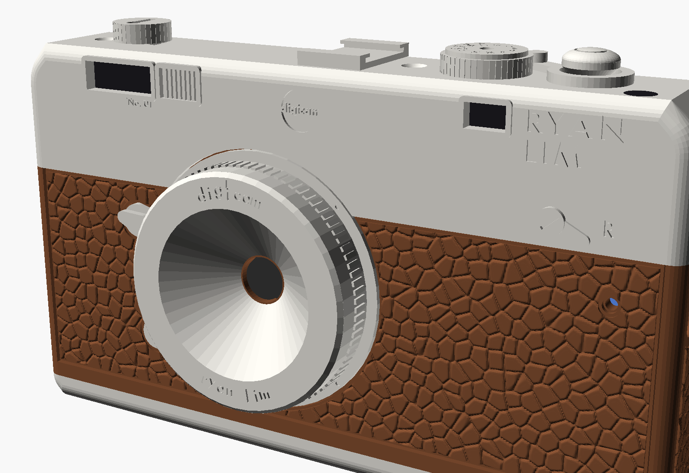
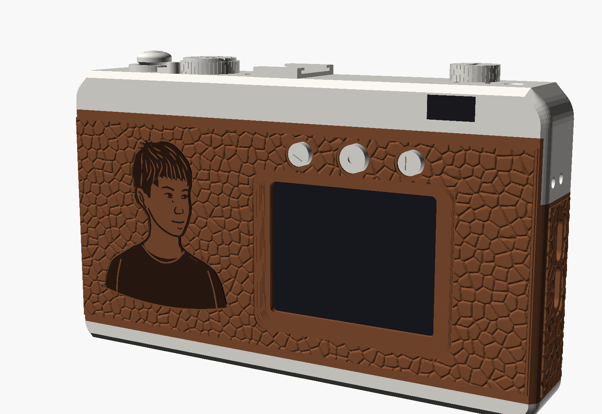
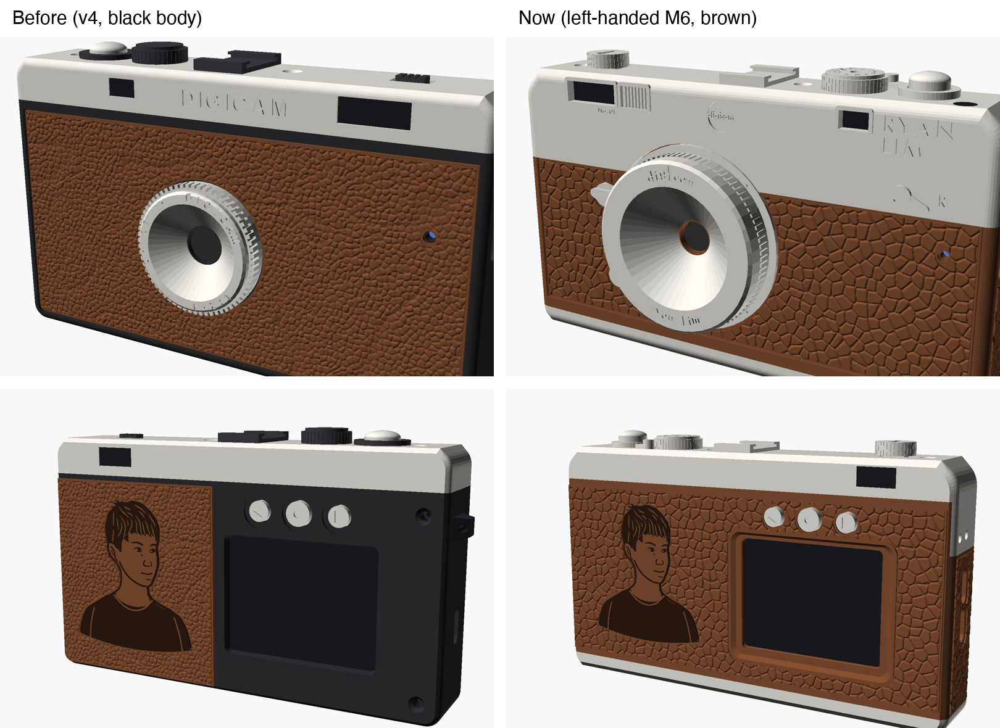
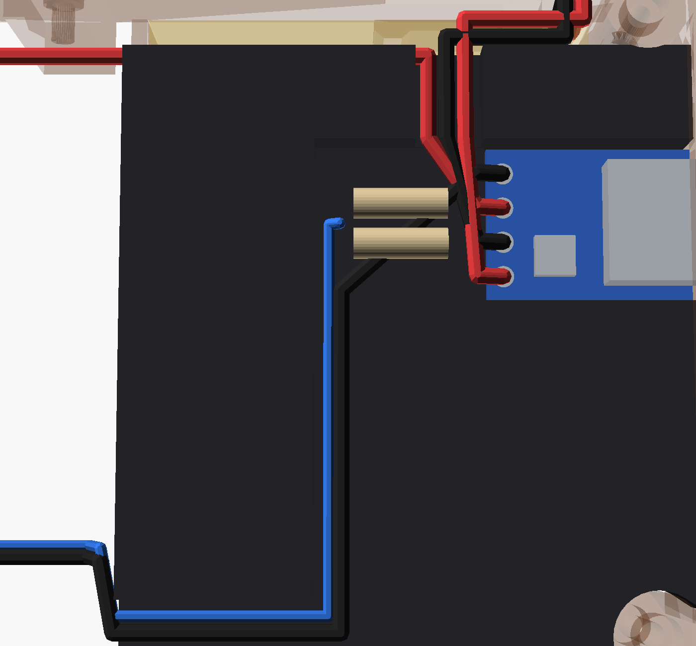
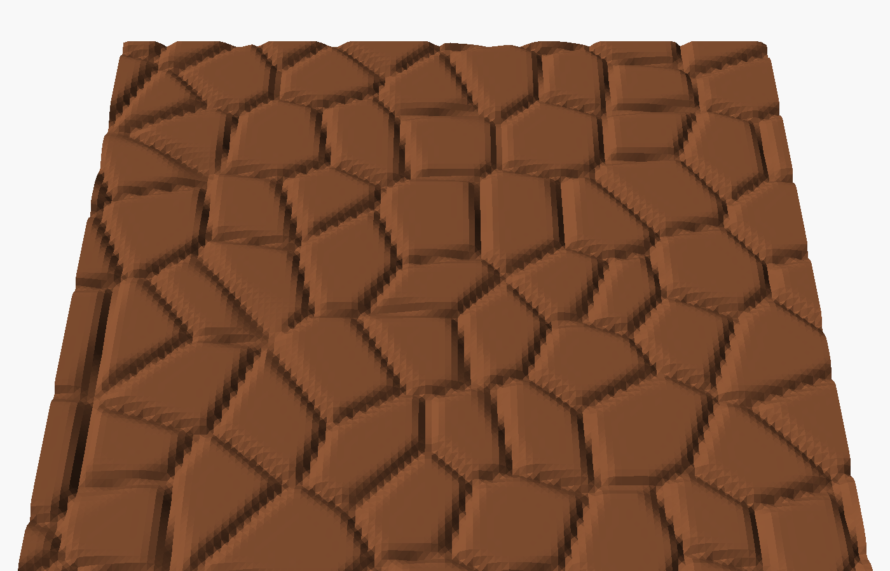
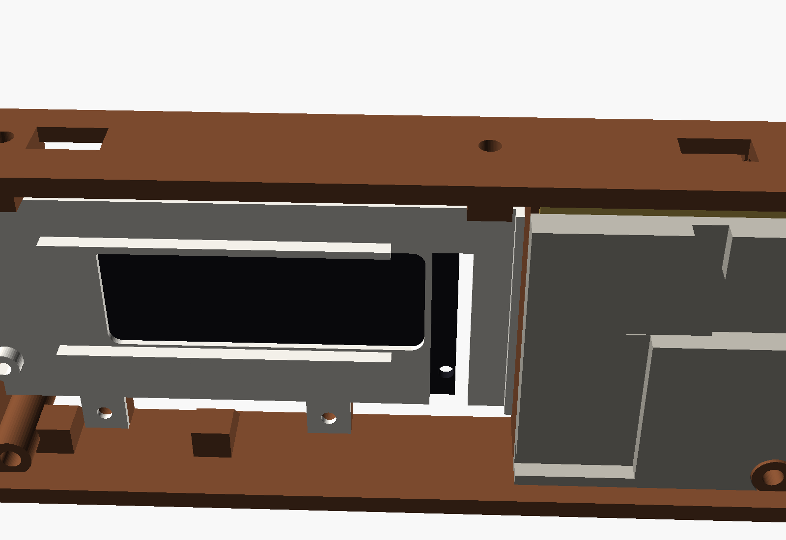
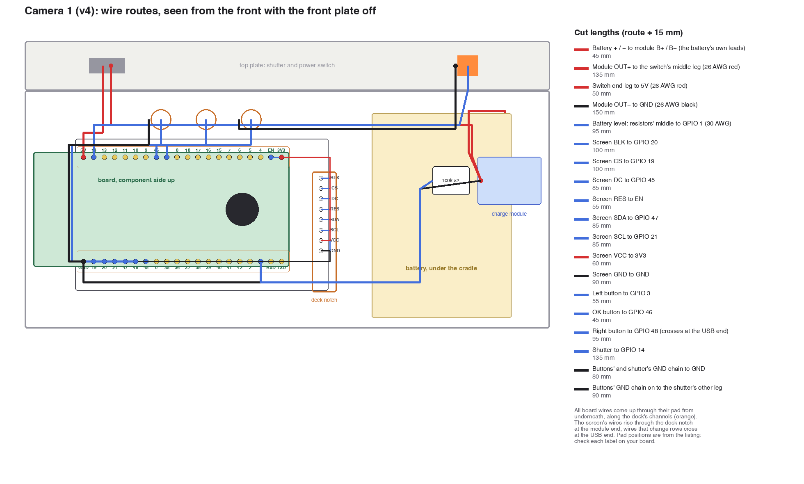
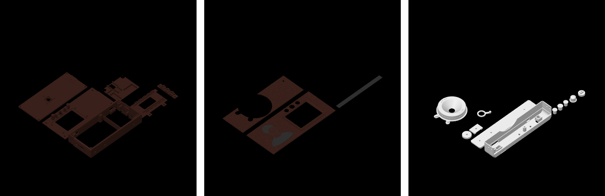
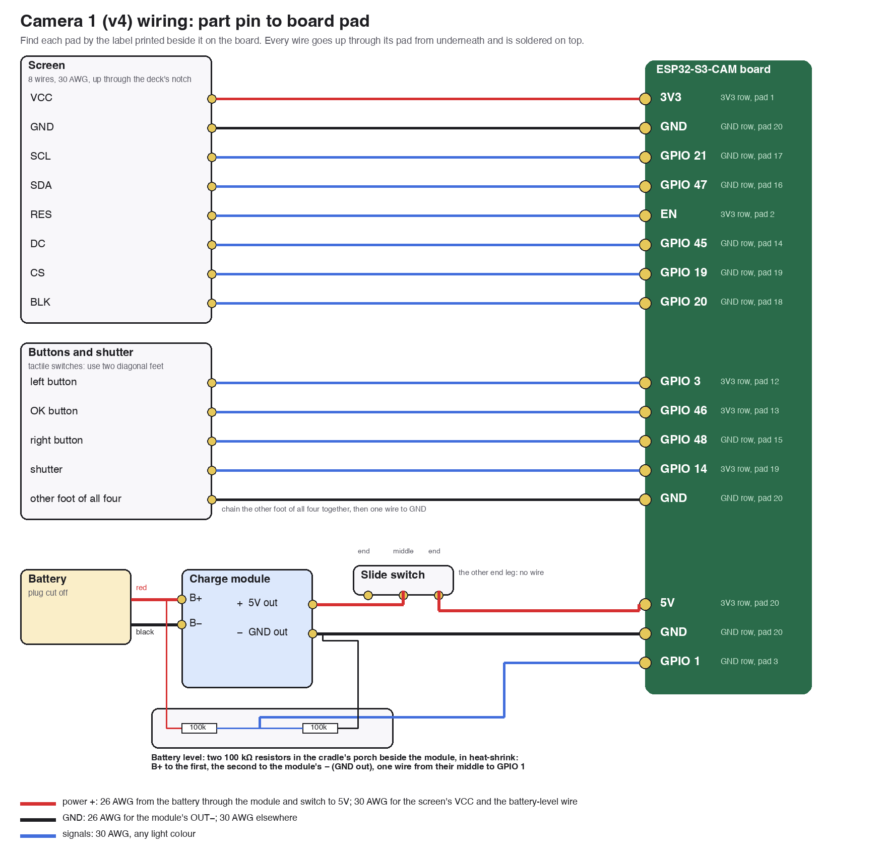

# Assembly guide: camera 1, v4

24 Oct 2026. **This replaces v3.**
- **Interactive 3D version:** https://claude.ai/artifact/DiW4ahkaxnJSFWHVGkqasu (source `guide-v4/`; pieces from `cad/guide_parts_v4.scad`, bundled by `cad/export_guide_v4.py`).
- Model: `cad/camera1_v4.scad`.
- Print files: `cad/export/v4/`.
- Ready-to-print Bambu project: `cad/export/v4/camera1_v4_plates.3mf`.

v4 is the retro body rebuilt around the parts as measured. The 2.0 in screen (61.7 × 37 × 4 mm) and the board with its antenna overhang (66.9 mm) didn't fit the v3 frame. The frame is new and must be reprinted.

## The outside: Leica M6 style and proportions, in brown (25 Oct)

**26 Oct, overnight prints:** the parts nothing still under test depends on.
- **Plate 7 (silver):**
  - the bottom plate, which screws to the frame's unchanged bottom bosses;
  - the lens barrel;
  - the three button caps and the shutter cap;
  - the speed dial, shoe and advance lever.
- **Plate 8 (brown):** the front covering, which is also the first print of the new grain.
- **Still to come:**
  - the back covering and its inlay, after the portrait's edits;
  - the top cover and the knob, after its shutter and switch are tried;
  - the dark window card, with the back covering's black.

**26 Oct, the buttons:**
- **Bigger wire holes in the carrier:** 1.8 × 2.25 mm (they were 1.0 × 1.6), so a 26 AWG wire goes through beside each foot. The rest of Allen's pocket is unchanged.
- **The buttons are 14 mm apart** (they were 11), so the holes of one switch are 2 mm from the next switch's holes and the legs can't touch. The caps, their sleeves and the carrier's posts on the back plate follow; the buttons stay centred over the picture.
- **Plate 6** is a button test: the back plate and the carrier (29 min). The same two parts are on plate 4 with the frame and deck.

**26 Oct, the battery side:**
- **The power cradle is now a block** that fills the space between the battery and the front plate. It wraps snugly round the two corner posts beside the battery, so it can only sit one way, with the module's USB-C on its opening. The old cradle could slide over the divider, which is why its pocket drifted.
- **The module's pocket is snug:** 0.15 mm clearance, with a step at its pads as an end stop.
- **The wires lie in grooves cut into the block:**
  - a porch at the pads, with room for the two resistors;
  - a groove up to the open lane along the top, for the battery leads and the 5V out to the switch;
  - a groove down and along the bottom to the divider, for GND and the battery-level wire.
- The front plate still presses on the block round the module, so it holds the module and the battery. It checks clean against your first frame too, resting on its divider and strap boss.

**26 Oct:**
- **The deck sits 1 mm higher.** The frame's four deck bosses (the two bottom tabs and the two under the board's holes) are 1 mm taller, giving the parts on the screen's back room. The deck, the board and the camera rise with them, and so do the board's two USB-C openings in the right wall. There's now 1.5 mm between the screen's back and the deck: use two strips of 1.5 mm foam (or 1 + 0.5 mm stacked).
- **Thin tape under the camera:** use 0.2 mm double-sided tape, not 0.4 mm foam. With the board 1 mm higher, that keeps the camera 0.3 mm clear of the front plate without making the body any thicker, so the front plate, top cover and coverings don't change.
- **Plates:**
  - Plate 4 reprints the frame, back plate and deck (1 h 22 min, 43 g). The four-leg carrier from before is unchanged.
  - Plate 5 is a battery test: the power cradle and the front plate (30 min, 22 g), to try the battery side in your first frame. That side of the frame hasn't changed.

**After the test print (25 Oct, evening):**
- **The screen sat on the four pillars.** They were rings round the locating pins, meant to hold the screen's board at the right height. The screen is a little thinner than the 4 mm I'd modelled, so the rings carried it and the glass hung above its pocket.
  - The rings are now a short base, so the glass rests on the pocket's floor and the pins only locate it.
  - The pocket is now the screen's full width and as long as the pins allow, so any glass or panel drops in.
  - Quick check on your printed plate: cut the four rings down to the plate with a flush cutter, leaving the thin pins, and the glass drops in.
- **The sled rode on the screen's back.** Because the screen sat high, the gold flex and the small parts (R1–R3) by its pins lifted the sled off its bosses.
  - The sled now has a big opening over them and over the middle of the screen. It bears on two foam strips along the screen's long edges instead of one pad.
- **The wires hit the ESP32 module's overhang.** The module overhangs its board by 4.5 mm at that end, right above the screen's pins.
  - The screen moves 4 mm toward the battery, so its pins clear the overhang by about 2 mm and the wires rise freely.
  - A wire tray beside the pins gives the bundle, and the power wires from the cradle, room to bend before they go into the lanes.
  - Each screen wire is now 5 mm longer: see the table. That comes out of the 15 mm slack on wires you've already cut.
- **A smoother screen surround.** The covering's frame round the screen is now a curve: it falls steeply from the leather at first, then flattens out down to the glass, and its outer edge is rounded. The back plate's part stays a short 45° bevel, because the plate prints face down over the window.
- **The button carrier takes the real switches.** The back buttons are 6 × 6 mm SMD switches with four legs, not the 5 × 5 two-foot switches I'd modelled. The v4 carrier now uses Allen's pocket design from his v3 carrier (PR #2): a 6.2 mm pocket with the snap catch at 3.6 mm, a notch in the side wall for each leg so there's room to solder, the feet sunk into the floor, and a wire hole just past each foot. It sits at v4's positions and screws to v4's posts; his v3 file itself doesn't fit v4 (its posts are 40 mm apart, v4's are 38). Use two diagonal legs on each switch.
- **Window 1 mm toward the screen's pins** (to the right, seen from inside the back plate), to match the picture on the real screen; the leather's frame moves with it, the buttons don't (the printed carrier still fits).
- **Wider wire lanes for 26 AWG:** the channels' outer walls are gone and the ribs moved 1.5 mm further in, so a row's wires lie side by side under and beside the board's edge (the channels were 2.1 mm: one 26 AWG wire). The deck now reaches the screen's top edge.
- **The screen's pins** are 27.8 mm apart across (measured between hole centres); they were 29.0, so only one pair would go in at a time.
- **Room for the foam:** the pocket's floor is now 0.6 mm, so the screen sits 0.2 mm deeper and there's 0.5 mm between its back and the sled. Two strips of 0.5 mm foam fill it, and the sled still sits on its bosses. The sled, the board and the frame are unchanged, so the board's USB-C sockets still line up with their holes. With thicker foam the sled won't reach its bosses: use 0.5 mm.
- **The shutter's cradle** in the top cover takes the same 6 × 6 four-leg switch. It hangs from the ceiling now; it had been a loose block below it, which would have printed as strands. The shutter cap gets a 5 mm stem and a 6 mm flange so it goes in from inside, through the cradle, before the switch.
- **The sled's two screw holes at the board's USB end** were 0.2 mm from its edge, too thin to print; they're now slots open to the edge (the screws still clamp it).
- **Model clean-ups (no reprint needed):** the bottom-left corner post is now joined to both walls (it was 0.2 mm off them, which your printer will have fused anyway); two loose specks in the cradle's corners are gone.
- **What to reprint:** the back plate, sled and button carrier, on the Bambu project's plate 4 ("Reprint after the test", 34 min). The carrier moves with the buttons, which follow the screen. Your frame, front plate and cradle are unchanged: checked, identical.

**Last fixes (25 Oct):**
- **The screen is turned round,** its pins by the board's module end, near 3V3, to match the screen wires as they're already cut. The picture would then be upside down, so the firmware turns it round. `LCD_TURNED` in `firmware/main/pins.h` mirrors both axes, the same as a 180° turn; the camera's photos aren't affected. The deck's notch moved with the pins, and the screen's wires now go into the channels from their module end. The cut lengths below are recomputed: check your soldered wires against them.
- **No sudden drop at the screen.** The glass sits 1.2 mm deep in a pocket in the back plate. From the glass, a short 45° bevel in the back plate (45° because the plate prints face down over the window) runs into the covering's smooth frame. The frame carries the slope on up at about 22° to the leather, and stands 0.2 mm proud. The slope is steeper along the top edge, where the buttons leave less room. The camera is 0.3 mm thinner for it.
- **A fuller silver front, like the M6's:**
  - raised rims round the three front windows, like its chrome bezels;
  - a round badge where its red dot is, "digicam" standing in a shallow recess (paint the recess red if you like);
  - the rewind lever, with its slotted pivot and an R, at the leather line under the name;
  - a small "No. 01" under the viewfinder, where the M6 has 0.58.
- **Text:** the lens reads "digicam" over the top and "ryan lim" along the bottom. The bottom plate reads "digicam · ryan lim". Both are in Futura, like the name.
- **Both USB-C sockets** on the board now have an opening in the end wall. The second one (OTG) is a backup for power. It can't carry data, because its lines (GPIO 19 and 20) drive the screen.

**Left-handed.** Ryan is left-handed, so this is the M6 mirrored:
- On the left as you hold it: the shutter, speed dial, advance lever and frame counter.
- On the right: the rewind-style knob (the power switch), the viewfinder and the eyepiece.
- From the front, the name sits beside the rangefinder window at the right, and the lens release and frame selector are left of the lens.
- The lens stays left of centre seen from the front, where the board puts it. That's the mirror image of the M6, where it's right of centre.

**Size.**
- The M6 is 138 × 79 × 38 mm (the TTL). This body is 128 × 73 × 22 mm: the M6's width to height, at 93 % of its size.
- It can't be shorter, because the battery stands 50 mm tall. So it got wider (from 116 mm) to keep the proportion.
- It stays slimmer than the M6: the inside needs only 22 mm of depth.

**Silver and brown in the M6's ratio.**
- The silver cover comes down the front and both ends to 44 mm from the bottom. Silver is now a third of the height, brown leather 60 %, and the bottom plate the rest, as in the M6 photo.
- The back stays leather up to the top plate, round the portrait and the screen.
- The body is brown all over (frame and plates print in the leather's brown), so the only colour changes are the M6's: leather to silver.

**Rounder.**
- All the body's edges are 3 mm round (they were 2 mm).
- The cover's top corners are 8 mm round seen from the front, and the bottom plate's are 4.5 mm.

**Name.** RYAN over LIM, right-aligned at the left of the front, laid out like the M6's LEICA over M6. It's in Futura, the closest font to Leica's engraving: wide letters, a pointed A and a splayed M.

**Lens.** The barrel is 44 mm across (it was 30) and 10 mm deep. Like the M6's lens, it overlaps the silver cover's edge.

**Strap holes.** Two small holes through each end, 6 mm apart, joined by a U-shaped tunnel inside a solid block of the frame. Thread a phone wrist strap's cord in one hole and out of the other. The pull goes into the frame, not the cover.

**Fewer loose parts:**
- the mount ring, lens release button and frame selector lever are now part of the lens barrel;
- the four dark window inserts and the frosted insert became one dark card glued behind the two front windows;
- the frosted window's ribs are part of the cover;
- the eyepiece and frame counter are recesses for a black marker;
- the screen's bezel is now a smooth raised frame in the back covering.

So 9 loose prints became 1. Still separate, because they can't be printed in place:
- the three top controls, which are glued on after the cover screws down;
- the wiring deck, power cradle and button carrier (see "Why these stay separate" below).

**Leather that prints with a 0.4 mm nozzle.**
- The first grain was 1.4 mm rounded pebbles. That's only 3 lines of a 0.4 mm nozzle, so it printed as loose, flaky terraces.
- The new grain is bigger, flatter pebbles, about 3 mm across, with flat tops and 0.7 mm grooves, 0.4 mm deep, between them. The covering's top is one flat, smooth surface, and the grooves are what you see and feel.
- You don't need a 0.2 mm nozzle. Bambu Studio's fuzzy skin can't do this either: it only roughens side walls, not the top surface the grain is on.

**Why these stay separate:**
- **Wiring deck:** it sits on the screen, which goes in after the frame is on the back plate. Fused to the frame, it would hang in mid-air as printed.
- **Power cradle:** it lies on the battery, which goes in first.
- **Button carrier:** the caps drop in from inside before it.
- The corner posts and every boss were already part of the frame; none was ever a separate part.

**The battery** (the 2000 mAh 103450 cell, measured 10 × 34 × 50 mm on 10 Oct):
- It rests on 1 mm foam tape, against the divider and the bottom wall.
- Three spring tabs push it there: two from the left, one from above. They're thin cantilevers with a round nub, about 1 N each.
- It can't rattle, a cell up to about 0.8 mm bigger still fits, and nothing presses hard on the pouch.
- The cradle above it and the front plate stop it moving forward.

**Inside, nothing else moves.** The parts' positions relative to the board are the same; the extra 12 mm of width sits between the battery and the screen.

The fit check passes: 210 pairs, none overlapping.

## What's new inside

- **The screen sits on four pins** through its own corner holes, so it lines up with the window by itself. No tight lip.
- **A wiring deck** sits between the screen and the board:
  - two ribs carry the board between its pad rows, so nothing is under a pad;
  - along each pad row runs an open lane, under the board's edge strip and on beside it: about 9 mm wide along the bottom row and 6 mm along the top, for a row's 26 AWG wires side by side;
  - the screen's 8 wires rise through a notch at the board's USB end, open at the edge, so the soldered bundle slides in rather than being threaded.
- **The board and the deck share two screws** at the board's two holes, into inserts in the frame.
- **A power cradle** lies on the battery and holds it down:
  - a pocket for the charge module, its USB-C lined up with its port;
  - a slot for the two battery-level resistors right at the module;
  - guides for the wires.
- **The pin plan is regrouped** so wires are short:
  - the screen's pins sit by the board's module end, so its VCC and RES go straight into the first two pads, and the other six run along the GND row to the USB end;
  - the back buttons land on the pads just below them.

  **The firmware is updated to match** (`firmware/main/pins.h`). Flash it before you test.
- **One rule for the board:** every wire comes up through its pad from **underneath** and is soldered on top. The board's top stays clear.

## 0. Measure before you print

These are still estimates from the seller's photo. A wrong value shows up only in the part listed, so check with calipers and change the number in `camera1_v4.scad` before printing that part.

| What | Value used | Affects |
| --- | --- | --- |
| Board: TTL USB-C socket centre, from the **GND-row** long edge | 8.6 mm (`usb_ttl`) | the frame's USB hole |
| Board: how far the USB-C sockets stick out past the PCB end | 0.6 mm (`usb_over`) | the board's fit in the frame |
| Board: PCB thickness | 1.5 mm (`board_pcb`) | heights of the USB hole and lens |
| Board: first pad's centre from the module-end edge; pad rows from the long edges | 1.9 / 1.3 mm (`pad0`, `pad_edge`) | channel positions (forgiving) |
| Board: lens centre from the PCB's module end | 11.5 mm (`lens_from_end`) | the front plate's lens hole |
| Charge module: USB-C centre above its underside; how far it sticks out | 2.2 / 0.6 mm | the frame's left USB hole |
| Charge module: where its charge LED is | 9 mm from the USB end | the peep hole |
| Screen: glass width | 35.9 mm | nothing now (pins locate it) |
| Tactile switch: base to metal top | 3.5 mm (`btn_body`) | the carrier's snap fingers |

Then run `python3 cad/export_v4.py` (parts and fit check) and `python3 cad/make_plates_v4.py` (Bambu project).

## 1. What you need

### Printed (Bambu project; print plate 1 first and test)

| Plate | Parts | Filament | Time |
| --- | --- | --- | --- |
| 1 **Test first** | frame, back plate, front plate, wiring deck, power cradle, button carrier | PLA Wood brown (the deck, cradle and carrier are hidden, so brown is fine) | 1 h 50 min, 64 g |
| 2 Coverings | front and back coverings, with the portrait inlay; the dark window card | PLA Wood + black | 1 h 5 min, 16 g |
| 3 Silver | top cover, bottom plate, lens barrel, 3 button caps, shutter cap, knob, speed dial, shoe, advance lever | PLA Basic white (or silver) | 1 h 10 min, 36 g |
| 4 **Reprint: frame, back plate, deck, carrier** | frame (deck bosses 1 mm higher), back plate, wiring deck, button carrier | PLA Wood brown | 1 h 27 min, 44 g |
| 5 **Battery test** | power cradle (the new block), front plate | PLA Wood brown | 30 min, 22 g |
| 6 **Button test** | back plate, button carrier (14 mm apart, bigger wire holes) | PLA Wood brown | 29 min, 15 g |
| 7 **Overnight, silver** | bottom plate, lens barrel, 3 button caps and the shutter cap, speed dial, shoe, advance lever | PLA Basic white (or silver) | 41 min, 20 g |
| 8 **Overnight, brown** | front covering (0.1 mm layers: the first print of the new grain) | PLA Wood brown | 24 min, 5 g |

**Test first:**
1. Print plate 1 and build the inside: steps 1 to 11, with the desk test at the end of step 11.
2. Check the screen on its pins, the board and both USB-C sockets in their holes, the battery in its springs, the buttons, and the charge module and its LED.
3. Change a number in `camera1_v4.scad` and reprint just that part if anything is off, before printing plates 2 and 3.

**Settings:**
- Everything uses Bambu's "0.20mm Standard @BBL P2S" preset, with 3 walls and no supports.
- The coverings print at 0.1 mm layers, face up, so each groove is 4 layers deep.
- In the coverings' top-surface settings, use Monotonic line and leave ironing off.
- Click **Sync with AMS** before slicing. Without an AMS, delete the inlay part on plate 2 and paint-fill the sunk portrait.

### Screws and inserts

| Item | Qty | Where |
| --- | --- | --- |
| M2 heat-set inserts, 3.5 mm OD | **19** | frame: 8 in the corner posts (both ends), 2 in the deck's bottom bosses, 2 in the bosses under the board's holes, 2 under the top wall, 2 in the bottom wall (from below); 3 in the lens barrel |
| M2 × 5 **countersunk** (flat head) | **8** | back plate (4) and front plate (4). All eight hide under the coverings |
| M2 × 8 countersunk | **2** | bottom plate, from below |
| M2 × 8 button head | **2** | board + deck into the frame, through the board's two holes |
| M2 × 4 button head | **2** | the deck's bottom tabs into the frame |
| M2 × 5 button head | **3** | lens barrel, from inside the front plate |
| M2 × 6 (or × 5) | **2** | button carrier to the back plate (self-tapping into plastic) |
| M2 × 14 countersunk (or × 12) | **2** | top plate, from the top |

### Everything else

The electronics, wire, tape and tools are as in `12-packing-list-retro.md`, with these changes:
- **Foam:** two strips of 1.5 mm foam (or 1 + 0.5 mm stacked) between the screen and the deck. 0.2 mm double-sided tape under the camera.
- **No foam on the charge module:** the cradle and front plate hold it.
- **Insert iron:** about 200 °C for PLA.

## 2. Wiring

The 3D guide's **Wire by wire** step (step 4) goes through all 21 wires one at a time. For each, it shows the wire lit up in the camera, where it starts and ends, its type and cut length, and the way it runs.

| From | To (board pad) | Wire | Cut |
| --- | --- | --- | --- |
| Screen VCC | **3V3** (3V3 row, pad 1) | 30 AWG red | 60 mm |
| Screen GND | **GND** (GND row, pad 20) | 30 AWG black | 90 mm |
| Screen SCL | **GPIO 21** | 30 AWG | 85 mm |
| Screen SDA | **GPIO 47** | 30 AWG | 85 mm |
| Screen RES | **EN** (3V3 row, pad 2) | 30 AWG | 55 mm |
| Screen DC | **GPIO 45** | 30 AWG | 85 mm |
| Screen CS | **GPIO 19** | 30 AWG | 100 mm |
| Screen BLK | **GPIO 20** | 30 AWG | 100 mm |
| Left button | **GPIO 3** | 30 AWG | 55 mm |
| OK button | **GPIO 46** | 30 AWG | 45 mm |
| Right button | **GPIO 48** | 30 AWG | 90 mm |
| Shutter (left end) | **GPIO 14** | 30 AWG | 135 mm |
| Other foot of the three buttons, chained | **GND** | 30 AWG black | 80 mm (+ two 18 mm jumpers) |
| … and on from the chain | the shutter's other leg | 30 AWG black | 85 mm |
| Battery red / black | module **B+ / B−** | battery's own leads | about 45 mm |
| Module OUT+ | slide switch **middle** leg (right end) | 26 AWG red | 135 mm |
| Slide switch **end** leg | **5V** (3V3 row, pad 20) | 26 AWG red | 50 mm |
| Module OUT− | **GND** | 26 AWG black | 150 mm |
| B+ - 100 kΩ - (middle) - 100 kΩ - the module's **−** (GND out), in the cradle's porch | middle to **GPIO 1** | 30 AWG | 95 mm |

- **The charge module (CZ001) has four pads at the end opposite its USB-C:**
  - **B+ and B−** take the battery's own red and black leads (you've done these).
  - **+ and −** are its boosted 5 V output. That's what feeds the ESP32:
    - **+** goes to the slide switch's middle leg, and one end leg of the switch goes to the board's **5V** pad.
    - **−** goes straight to the board's **GND** pad.
  - Nothing from the battery goes to the ESP32 directly.
  - The battery-level divider goes from **B+** to the module's **−**. If the module has a protection switch in the B− line, B− isn't quite the ESP32's ground, but **−** is.
- **What the two resistors are for: the battery gauge.** The ESP32 can't measure a LiPo directly, because its pin only reads up to about 3.1 V and the cell goes up to 4.2 V. The two equal resistors halve the voltage (4.2 V becomes 2.1 V), and GPIO 1 measures that. The firmware already uses it: the battery icon and percentage on the screen, the voltage under Settings > About, a warning at 10 %, stopping a video before the cell runs flat, and the percentage on the phone page. Without the resistors the camera works, but it can't tell you how full the battery is. The pair draws 0.02 mA, nothing next to the camera.
- **Fitting them without branching a wire:**
  1. Solder one resistor's leg straight onto the module's **B+** pad, next to the battery's red wire (the pad takes both).
  2. Solder the other resistor's leg onto the module's **−** pad, next to the GND wire.
  3. Twist the two free legs together with the GPIO 1 wire, solder them, and cover the joint with heat-shrink.

  The two resistors lie in the cradle's porch.
- **Switch it off to flash.** Turn the slide switch off before you plug a cable into the ESP32's own USB-C (to flash it or use the serial monitor), so the module's 5 V and the cable's 5 V don't meet. The module's own USB-C (charging) is fine at any time.
- **GND pad:** it gets three wires (OUT−, screen GND, the switches' chain). Push the 26 AWG one through the hole; solder the two thin ones onto the same pad.
- **Switches:** use two diagonal feet on each 5 × 5 switch.
- **Insulate:** heat-shrink every joint.

## 3. Build

**Before anything:** flash the updated firmware (`idf.py -p /dev/cu.wchusbserial10 flash` in `firmware/`, through the **TTL** socket). The OTG socket has an opening too, but only for power (a backup): GPIO 19 and 20, its data lines, drive the screen.

1. **Inserts:** 16 into the frame (2 of them up into the bottom wall from below), 3 into the lens barrel (iron at about 200 °C).
2. **Solder on the desk.** Everything stays loose and connected:
   1. The screen's eight wires go to its pads.
   2. The other ends go **up through** the board's pads from underneath, then are soldered on top.
   3. Do the same for the buttons, the shutter, 5V, GND and GPIO 1.
   4. The two resistors go into heat-shrink at the charge module.
3. **Test on the desk:** the screen lights, every button and the shutter work, the battery reading shows, and the camera runs on battery through the switch.
4. **Back plate**, face down on a cloth:
   1. Drop the three caps into their sleeves.
   2. Snap the switches into the carrier.
   3. Screw the carrier to its two posts.
5. **Screen:** glass down onto the four pins, its pins toward the board's module end (toward the battery). The glass drops into its pocket and rests on its floor.
6. **Foam:** two strips of 1.5 mm foam along the long edges of the screen's back, clear of the gold flex and the small parts by its pins.
7. **Frame** onto the back plate: 4 countersunk M2 × 5 from the back.
8. **Battery** into its bay on two strips of 1 mm foam tape, leads at its top edge by the charge module (top right, seen from the front). Push it against the two spring tabs on the left, then down past the one above it.
9. **Deck:**
   1. Lower it onto the screen, sliding the screen's bundle into the notch from the left or bottom edge.
   2. Fit 2 × M2 × 4 through its bottom tabs.
10. **Board:**
    1. Lay each wire in its lane: the screen's wires from the notch, VCC and RES into the 3V3 row's first two pads, the other six along the GND row; the buttons' wires in from the side through the wall gaps.
    2. Set the board on the ribs, USB end to the right wall, with the TTL socket in its hole.
    3. Fit 2 × M2 × 8 through the board's holes and the deck into the frame.
11. **Power cradle** onto the battery: it fits over the two corner posts beside the battery, so it goes in one way only.
    1. The module into its pocket, USB-C into its hole in the end wall, pads facing in. Solder its wires so they leave the pads flat, along the board, not looping over it.
    2. The resistors lie in the porch beside the pads.
    3. The battery's leads come out of its top edge into the open lane along the top, then down the groove beside the porch to B+ and B−. The 5V out (+) goes back up the same groove and along the top to the switch.
    4. The − out (GND) and the GPIO 1 wire go down the groove past the resistors and along the bottom, over the divider, then on along the deck beside the board.
    4. **Test while it's open:** power on, the screen, the buttons and the shutter (its switch hangs on its wires for now), and charging (the LED in its peep hole).
12. **Front plate:**
    1. Screw the lens barrel on from inside (3 × M2 × 5). Its base is the mount ring, with the lens release and frame selector.
    2. Lower the plate: the collar centres the camera, and its rim presses on the charge module.
    3. Fit 4 countersunk M2 × 5.
13. **Silver top cover** (after the front plate: it hides the front plate's top two screws):
    1. Inside the cover, glue the dark window card behind the two front windows. Black in the eyepiece and the frame counter with a marker.
    2. Pass the shutter switch (left end, as you hold it) and the slide switch (right end), wires attached, up through their passages in the frame's top wall.
    3. The shutter cap goes in first, from inside: stem up through the cradle and out of its hole in the top, its flange under the ceiling.
    4. Push the shutter switch (the same 6 × 6 four-leg switch as the back buttons) up into its cradle, plunger first, until the two fingers click under its base; its legs come out through the side notches. Push the slide switch into its pocket, knob through the slot (a dot of hot glue).
    5. Slide the cover down: its front and ends come down over the frame to the leather line. 2 countersunk M2 × 14 from the top.
    6. Glue on the speed dial, the shoe and the advance lever (its hub round the shutter).
14. **Bottom plate:** its peg into the hole under the shutter's end, then 2 × M2 × 8 countersunk from below.
15. **Coverings:** thin double-sided tape.
    1. The front one drops into the rim below the silver cover, round the lens's mount ring.
    2. The back one covers the whole back round the screen and the buttons and hides all four back screws.
16. **Wrist strap:** thread its cord in one of the two holes at either end and out of the other.

**Taking it apart:**
1. Take off the strap, undo the 2 top screws and lift the cover off.
2. Peel the front covering (it's on tape).
3. Undo the 4 front screws.
4. Everything inside comes out without cutting anything.
